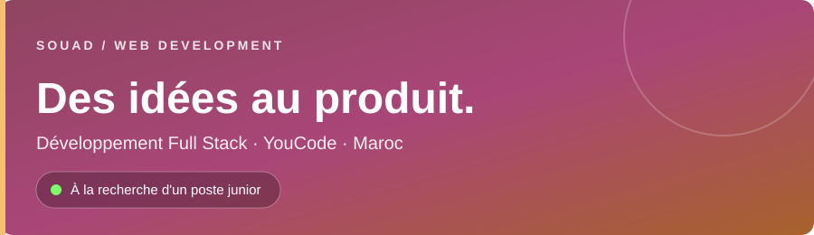

  <a href="https://github.com/souad5017/LSM-Backend">LSM-Backend</a> ·
  <a href="https://github.com/souad5017/JobFix">JobFix</a> ·
  <a href="https://github.com/souad5017/qodex_student_quiz">Qodex Student Quiz</a> ·
  <a href="https://github.com/souad5017/job-board">Job Board</a> ·
  <a href="https://github.com/souad5017/warmup-javascript">Memory Card Game</a> ·
  <a href="https://github.com/souad5017/Portfolio">Portfolio</a>

